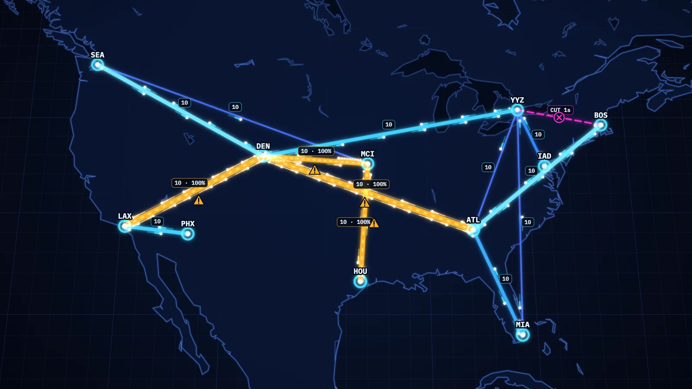

# Backbone

**Build the backbone. Never steer a packet. Predict where the congestion goes.**

Backbone is a browser game for network engineers. You are the architect of a growing backbone network. You lay fiber between sites, set link costs and upgrade capacity, and every packet takes the lowest-cost path as OSPF would route it. Each change reroutes everything, and the game shows you where the load went.

A project from **NAF AC6 — Loop Engineering, Spec-Driven Development & the Future of VibeOps**, built as an example for the workshop Arcade.



| Project | Details |
| --- | --- |
| Status | **Playable v1, verified by automated tests.** Not yet played by a person on a real phone. Not listed in the Arcade. |
| Networking topic | OSPF shortest path by cost, equal-cost next hops, reconvergence after a failure (RFC 2328) |
| Typical session | The scripted player lasts 3 to 6½ minutes. How long a human run lasts has not been measured. |
| Live demo | Not published |
| Built by | Elliot Conner with Claude Code |

## The challenge

Three cities appear on a dark map and will start sending traffic to each other in 20 seconds. You drag fiber between them from an 8,000 km budget. More cities appear every 40 seconds. Every link starts at cost 10 and carries 4 packets a second in each direction. When a link fills, its queue backs up, it turns amber, and packets drop into the drop meter. One hundred drops and the run is over.

A typical decision: SEA–CHI is amber at 100%. You upgrade a parallel path and nothing changes, because capacity does not change cost. You pause, lower that path's cost by one, resume, and watch every pulse that was crossing SEA–CHI change course.

## What you'll learn

| By the end, you can… | You'll practice by… |
| --- | --- |
| Identify the lowest-cost path between two sites from link costs | Laying links, setting costs, and checking the inspector's "lowest-cost path" line against where the pulses go |
| Predict where load moves after a cost change, a new link or a cut | Making a change while paused, resuming, and watching utilization shift |
| Design redundancy so one fiber cut leaves no site dark | Surviving fiber cuts, which begin 2½ minutes into a run |

**Before playing:** you should know what a router, a link and a routing metric are. No OSPF configuration experience is needed.

## Play locally

The built game is in `dist/` and needs no install. From the repository root:

```sh
python3 -m http.server 8000 --bind 127.0.0.1 --directory dist
```

Open **http://127.0.0.1:8000**. Press Ctrl+C to stop the server. If port 8000 is busy, use 8001 in both places.

To work on the source you need Node (v26.3.1 was used):

```sh
npm ci
npm run dev        # development server
npm run build      # type-check, then build into dist/
```

## How to play

| Control | Action |
| --- | --- |
| Drag from one site to another | Lay a fiber link. The drag shows the length and whether you have the fiber. |
| Tap or click a link | Open its options: cost, capacity upgrade, remove |
| Pinch, or mouse wheel | Zoom |
| Two-finger drag, or drag empty map | Pan |
| Space, or the pause button | Pause and resume. Changes made while paused are queued and apply together when you resume. |
| 1, 2, 3 | Link, Cost and Upgrade tools. With Upgrade selected, a tap on a link upgrades it. |
| I, or the list button | Inspector: every link as a text table, a form to lay a link, and the lowest-cost path between two sites |
| Arrow keys and Enter on the map | Move between sites; Enter starts a link and Enter on another site finishes it |
| Escape | Close the open panel or cancel a keyboard link |

Every minute the clock stops and you choose a reward: 3,000 km of fiber or one capacity upgrade.

**Score:** packets delivered. Time survived is shown beside it. The five best runs are kept on the device.

**Seeds:** the seed decides which 12 of 18 cities appear and in what order, the traffic, and the fiber cuts. The same seed and the same actions give the same run.

URL switches for demos and testing: `?seed=NAME` starts a run directly, `&bot=1` lets the scripted player play, `&speed=1..32` runs the simulation faster, `&renderer=2d` forces the fallback renderer, `&motion=reduced` turns reduced motion on.

## What this game models

Single-area OSPFv2 over point-to-point links, one router per site. Each router computes shortest paths by total link cost and forwards hop by hop from its own table. A topology or cost change makes every router recalculate.

**Faithful to RFC 2328:** shortest path by summed cost (§16.1); costs are integers from 1 to 65535 (§C.3, §A.4.2); equal-cost next hops are all found (§16.1 step 2d, §16.8), and a router may keep fewer of them (§16.8), which in v1 is one; a link counts only when both ends report it (§16.1 step 2b); a change triggers recalculation (§13.2); cost is configuration and never reacts to load.

**Simplified for play:** convergence is instant; one cost per link for both directions; ties kept to one route go to the lowest router ID; packets are one size with a fixed-rate queue and tail drop, and senders never slow down; upgrading capacity does not change cost; only links fail; packets on a cut or removed link are lost. The full lists are in `StarterKit/SPEC.md` and in the game's "About the model" panel.

**Outside the model:** areas, Designated Routers, adjacency formation, flooding, timers, external routes, BGP, MPLS and traffic engineering.

| Reference | What it supports |
| --- | --- |
| [RFC 2328, OSPF Version 2](https://www.rfc-editor.org/rfc/rfc2328), §16.1, §16.1.1, §16.8, §13.2, §C.3, §A.4.2 | Path selection, equal-cost routes, the back-link check, recalculation, the cost range |
| [RFC 2991, Multipath Issues in Unicast and Multicast Next-Hop Selection](https://www.rfc-editor.org/rfc/rfc2991), §2–3 | Why per-packet sharing (planned for v1.2) is a simplification of real per-flow hashing |

## How it was built

Spec first, in the workshop StarterKit shape, with the owner approving the spec and then a visual mock before any game code was written.

- **Stack:** TypeScript, Vite, no runtime dependencies. The renderer is the project's own WebGL2 code with a Canvas 2D fallback; both draw one shared shape list. IBM Plex Sans and IBM Plex Mono are self-hosted.
- **Build tools:** Claude Code with model `claude-fable-5-2`. Vitest for unit tests, Playwright for end-to-end tests and video. GitHub Spec Kit was not used; the framework is "custom".
- **Runtime:** a browser. Static files only. No network, account, model or API key.
- **Spec artifacts:** `StarterKit/CONSTITUTION.md`, `StarterKit/SPEC.md`, `StarterKit/PLAN.md`, `tasks.md`, and `docs/PID.md`.
- **Records:** `PROVENANCE.md` (what was used and every verification step), `docs/capture-log.md` and `docs/runbook.html` (the build log and build book), `ARCADE.md` (the Arcade submission).
- **One useful design decision:** the simulation was written and tested before any drawing code, and the renderer only draws what the simulation computed. The time-lapse replay is the recorded commands re-simulated, which is also how the tests prove a run is reproducible.

## Verification

**Last checked:** 2026-11-09, macOS (Darwin 25.6.0, arm64), Node v26.3.1, Playwright 1.65.0 with its bundled Chromium headless shell 158.0.8127.18. Checked at commit `39a62da`.

```sh
npm test               # 33 unit tests (Vitest)
npm run build          # must come before the end-to-end tests: they run against dist/
npm run test:e2e       # 9 end-to-end tests (Playwright), 1 more skipped by design
npm run verify:dist    # dist/ equals a fresh build
```

| Check | Result | Evidence / notes |
| --- | --- | --- |
| Spec cases 1–8: path selection, ties, boundaries, reconvergence, per-hop split, no path | Pass | `tests/unit/spf.test.ts`, expected values copied from the spec into `tests/fixtures/ospf-cases.json` |
| Routing agrees with an independent brute-force oracle | Pass | 300 seeded random graphs, every router pair; the test asserts that ties and unreachable pairs really occurred |
| Mutation check | Pass | With the equal-cost rule disabled, 7 of the 13 routing tests failed |
| Spec cases 9–12: overload, invalid cost, score, determinism and replay | Pass | `tests/unit/sim.test.ts` |
| Drops, drop meter, cuts (including that a cut link cannot be removed), dark sites, rewards, command validation | Pass | `tests/unit/sim.test.ts` |
| Simulation is pure (no DOM, clock or `Math.random`) | Pass | Source scan in `tests/unit/sim.test.ts` |
| Spec routes compared with a real OSPF implementation (FRR) | Pass | `python3 tools/frr_check.py`: FRR 10.7.1 routers in Docker, all adjacencies Full, 13 of 13 expected routes match on cost and next hops, including after cost changes and cuts. Control plane only: it confirms the spec's expected values, not the game's packet forwarding. Two earlier attempts gave no valid verdict; see `PROVENANCE.md`. |
| Full seeded run at 1920×1080 with a mouse, and at 844×390 with touch | Pass | `tests/e2e/run.spec.ts`: lay links by drag, pause, pending changes, cost edit, invalid cost refused, upgrade, zoom, then the scripted player to game over; score re-simulated outside the browser and equal |
| Same run in the browser and in Node | Pass | Seed `stage-1` with the scripted player: 4,281 delivered in 5:04 in both browser sizes and in Node |
| Keyboard-only core loop | Pass | `tests/e2e/keyboard.spec.ts`, desktop size only |
| Reduced motion | Pass | Game plays and labels remain. That decoration is absent was checked by reading the code, not by a test. |
| No WebGL | Pass | WebGL contexts refused in the test; the game plays in the 2D renderer |
| No green or red | Pass | Source scan of every hex color, plus a hue count of rendered frames in both renderers (under 1% of strongly colored pixels in either band) |
| Card image | Pass | `public/hero.webp`, 1600×900, 76 KB |
| `dist/` equals a fresh build | Pass | `npm run verify:dist` |
| Seeded-run videos | Recorded | `docs/verification/run-stage-1-desktop-1920x1080.mp4` and `run-stage-1-phone-844x390.mp4`, simulation at 4× |
| Code review | Done | One `code-review` pass at level `medium`: 10 findings, all fixed, four with new tests. List in `PROVENANCE.md`, step 21. Not re-reviewed after the fixes. |
| 60 frames per second on a mid-range phone | **Not run** | Headless Chromium on a Mac held about 16.7 ms per frame, which says nothing about a phone |
| Played by a person; screen reader; real phone or tablet; Safari and Firefox | **Not run** | Only Chromium was tested |
| Briefing and model notes reviewed by a second person against the RFC | **Not run** | Written by the build agent from the sections it read |
| Fresh-clone run | Pass | Cloned the public repo at `39a62da` into an empty folder: `dist/` served and loaded with every asset; `npm ci`, 33 unit tests, build, `verify:dist` and 9 end-to-end tests all passed from the clone |
| Secret scan before the first push | Pass | gitleaks 8.30.1 over the project folder: no leaks found |

## Known limitations and next steps

- **Run length for people is unmeasured.** The constants were tuned against a simple scripted player.
- **Labels can overlap** where links are short or sites are close together.
- **On a phone the game-over panel covers the east of the map**, so part of the time-lapse is hidden.
- **Portrait phone layout** exists but was not tested.
- **The inspector does not trap focus**, and no screen reader has been tried.
- **Sharing the same seed does not share the same run** unless the same actions are taken; there is no way to export a replay.
- **Next:** v1.1 adds attract mode and sound for the stage; v1.2 adds equal-cost load sharing as a tool (the engine and tests already cover it) and maintenance windows; v1.3 the four-region campaign; v1.4 seed-generated maps. See `StarterKit/SPEC.md`.

Found a wrong route? Open an issue with the seed, the links and costs, the two sites, what the game did and what you expected.

## Credits

Created by Elliot Conner with Claude Code. Workshop by John Capobianco, Joksan Flores, and Elliot Conner. Spec artifacts adapted from the [NAF AC6 workshop materials](https://github.com/automateyournetwork/NAF_AC6) (Apache-2.0).

**Assets and dependencies:** coastline and lakes from [Natural Earth](https://www.naturalearthdata.com/) 1:50m data (public domain). [IBM Plex](https://github.com/IBM/plex) Sans and Mono (SIL Open Font License 1.1), bundled through the `@fontsource` packages. The hero image is a frame rendered by the game itself. Everything else is original to this project.

**License:** Apache-2.0. See [LICENSE](LICENSE).
